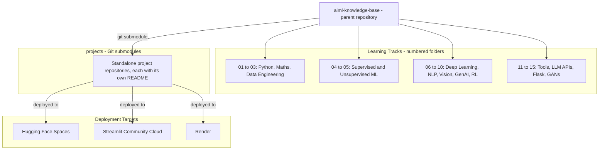
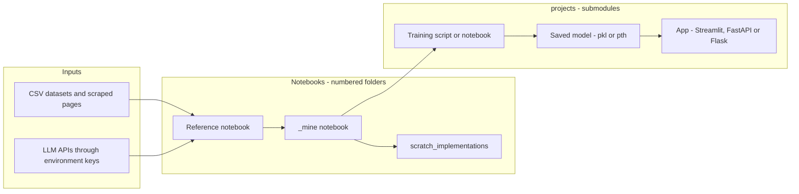

# AIML Knowledge Base

**One reference repository for my complete AI/ML learning path: Python and maths foundations, classical machine learning, deep learning, NLP, computer vision, generative AI and reinforcement learning, together with the deployed projects built from each topic.**


## Table of Contents

- [Problem Statement](#problem-statement)
- [Solution Overview](#solution-overview)
- [Key Features](#key-features)
- [Screenshots](#screenshots)
- [Repository Architecture](#repository-architecture)
- [Curriculum Map](#curriculum-map)
- [Projects](#projects)
- [Technology Stack](#technology-stack--complete-breakdown)
- [Workflow Lifecycle](#workflow-lifecycle)
- [Data and Artifact Flow](#data-and-artifact-flow)
- [Repository Layout](#repository-layout)
- [Getting Started](#getting-started)
- [Environment Variables](#environment-variables)
- [Working With Submodules](#working-with-submodules)
- [Troubleshooting](#troubleshooting)
- [FAQ](#faq)

## Problem Statement

Learning machine learning from lectures leaves notes, notebooks, assignments and mini-projects scattered across machines and platforms. Nothing records which concept produced which working application, and a notebook that "works on my machine" never becomes something another person can run or see.

## Solution Overview

This parent repository organises everything into numbered learning tracks (`01_` to `15_`). Every finished project lives in its **own repository** and is linked back here as a Git submodule under `projects/`, so a concept notebook and the deployed app that applies it are one clone apart. Each project keeps its own history, README and deployment, while this repository pins the exact commit of each one.

## Key Features

| Feature | Where to find it |
|---|---|
| Numbered curriculum from Python basics to GANs | `01_Python_Foundations` to `15_GANs` |
| Reference notebook plus a hand-written `_mine` re-implementation for each topic | for example `04_Supervised_ML/05_KNN/knn.ipynb` and `knn_mine.ipynb` |
| Algorithms rebuilt without the library | `04_Supervised_ML/scratch_implementations/` |
| Standalone projects registered as submodules | `projects/` |
| Live demos on Hugging Face Spaces, Streamlit Community Cloud and Render | linked in [Projects](#projects) |
| One pinned environment for all notebooks | `requirements.txt` |

## Screenshots

> *Add a project gallery image or demo GIF here, for example at `docs/images/projects-overview.png`. Each project's own README carries its screenshots.*

## Repository Architecture





## Curriculum Map

| Folder | Topic | What is inside |
|---|---|---|
| `01_Python_Foundations` | Python, NumPy, pandas | File operations and JSON lectures, NumPy and pandas notebooks with practice CSVs |
| `02_Maths_For_ML` | Maths for ML | Calculus, probability, probability distributions, statistics |
| `03_Data_Engineering` | Data collection, SQL, visualisation | Web scraping with BeautifulSoup, SQL joins and transactions, Matplotlib and Seaborn tutorials |
| `04_Supervised_ML` | Classical supervised learning | Linear and logistic regression, Lasso, Naive Bayes, KNN, decision trees, SVM (SVC and SVR), random forest, AdaBoost, gradient boosting, XGBoost, voting ensembles, scratch implementations, reference projects |
| `05_Unsupervised_ML` | Unsupervised learning | K-Means, DBSCAN, hierarchical clustering, PCA, anomaly detection with DBSCAN, Isolation Forest and LOF |
| `06_Deep_Learning` | Neural networks | Neuron from first principles, ANN classification and regression, PyTorch |
| `07_NLP` | Sequence models | RNN for sentiment analysis, Word2Vec notes |
| `08_Computer_Vision` | Convolutional networks | CNN on CIFAR-10, popular CNN architectures |
| `09_Generative_AI` | Transformers | Text summariser notebook |
| `10_Reinforcement_Learning` | Reinforcement learning | Q-Learning and SARSA; the deep Q-network agent is in `projects/flap_mind` |
| `11_Tools_and_Setup` | Tooling | Pydantic notebook, Git and GitHub task and cheat sheet |
| `12_LLM_APIs` | LLM APIs | Calling a hosted LLM from Python; the notebook uses the Google Gen AI SDK |
| `13_Flask` | Web basics | Flask app with routes, templates and static assets |
| `15_GANs` | Generative adversarial networks | Vanilla GAN and DCGAN notebooks; the CelebA project is `projects/face-forge` |

Retrieval-augmented generation is covered by the `projects/paper_sage` project rather than a notebook folder.

## Projects

Each project is a separate repository, pinned here as a submodule.

| Project | Path | What it does | Live demo |
|---|---|---|---|
| [Dwello](https://github.com/KARTHIKAKRISHNA123/dwello) | `projects/house_price_predictor` | Residential property price prediction with a Linear Regression pipeline and a Streamlit app | [Streamlit](https://dwello.streamlit.app/) |
| [RetentionRadar](https://github.com/KARTHIKAKRISHNA123/retentionRadar) | `projects/retention_radar` | Employee attrition and churn prediction | [Hugging Face](https://huggingface.co/spaces/KARTHIKAKRISHNA123/employee-attrition-prediction) |
| [PetalPulse](https://github.com/KARTHIKAKRISHNA123/petalPulse) | `projects/petal_pulse` | Iris species classifier from sepal and petal dimensions | [Hugging Face](https://huggingface.co/spaces/KarthikaKrishna123/Iris_Flower_Predictor) |
| [LendSure AI](https://github.com/KARTHIKAKRISHNA123/lendSure_AI) | `projects/lend_sure_ai` | Loan eligibility prediction with three scikit-learn classifiers and a Streamlit app | [Hugging Face](https://huggingface.co/spaces/KarthikaKrishna123/CreditWise) |
| [Intentify](https://github.com/KARTHIKAKRISHNA123/intentify) | `projects/intentify` | Cost-sensitive purchase-intent inference from clickstream signals | [Hugging Face](https://huggingface.co/spaces/KarthikaKrishna123/Intentify) |
| [VitaCheck](https://github.com/KARTHIKAKRISHNA123/vitacheck-ml) | `projects/vitacheck-ml` | Health risk classification with ensemble machine learning | [Hugging Face](https://huggingface.co/spaces/KarthikaKrishna123/vitacheck-ml) |
| [SegWise](https://github.com/KARTHIKAKRISHNA123/seg-wise) | `projects/segwise` | Customer segmentation with PCA and K-Means or Agglomerative clustering on 2,240 records, shown in a Streamlit dashboard | See repository |
| [PomologyAI](https://github.com/KARTHIKAKRISHNA123/pomology-ai) | `projects/pomology-ai` | Date fruit variety classifier | [Hugging Face](https://huggingface.co/spaces/KARTHIKAKRISHNA123/PomologyAI) |
| [GridSync](https://github.com/KARTHIKAKRISHNA123/grid-sync) | `projects/grid-sync` | Power plant net output predictor | [Hugging Face](https://huggingface.co/spaces/KARTHIKAKRISHNA123/GridSync) |
| [pixel-sense](https://github.com/KARTHIKAKRISHNA123/pixel-sense) | `projects/pixel-sense` | CNN trained from scratch on CIFAR-10 and served as a live demo | [Render](https://pixel-sense.onrender.com/) |
| [FlapMind](https://github.com/KARTHIKAKRISHNA123/flap-mind) | `projects/flap_mind` | Deep Q-Network agent that learns Flappy Bird through trial and error | See repository |
| [Face-Forge](https://github.com/KARTHIKAKRISHNA123/face-forge) | `projects/face-forge` | Vanilla MLP GAN in PyTorch that synthesises 64x64 faces from CelebA | See repository |
| [Brief-Sync](https://github.com/KARTHIKAKRISHNA123/brief-sync) | `projects/brief-sync` | Fine-tuned T5 summariser served through FastAPI with a custom web UI | See repository |
| [PaperSage](https://github.com/KARTHIKAKRISHNA123/paper-sage) | `projects/paper_sage` | Retrieval-augmented question answering over PDFs, built from scratch with local embeddings and ChromaDB | See repository |
| [FitMentor AI](https://github.com/KARTHIKAKRISHNA123/fitmentor-ai) | `projects/fitmentor-ai` | Real-time AI gym coach that reads the webcam, counts reps and checks form | See repository |
| [agent-verse](https://github.com/KARTHIKAKRISHNA123/agent-verse) | `projects/agent-verse` | Multi-agent playground built with Agno, Groq and Gemini, including the TubeLens YouTube analyzer | See repository |
| [Legacy Mind](https://github.com/KARTHIKAKRISHNA123/legacy-mind) | `projects/legacy-mind` | Flask AI assistant with Q&A and email summarisation on Groq-hosted GPT-OSS 120B | See repository |

## Technology Stack — Complete Breakdown

> Every library pinned in the root `requirements.txt`, plus libraries imported by the notebooks that it does not pin. Usage counts come from `import` statements in the tracked notebooks and scripts. Rationale is inferred from folder contents and each library's role.

### Imported in the notebooks and apps

| Technology / Package | Version | Category | Purpose in Project | Why Chosen | Key Features Used |
|---|---|---|---|---|---|
| scikit-learn | 1.6.1 | Machine Learning | Every classical model in `04_` and `05_` and the reference projects | Consistent fit and predict API across algorithms | Regression, classification, clustering, PCA, ensembles, train-test split, metrics, pipelines |
| pandas | 2.2.3 | Data Processing | Loading and cleaning every CSV dataset | De facto tabular data tool | DataFrames, groupby, merge, missing-value handling |
| NumPy | 2.1.3 | Core Scientific | Array maths under every notebook | Vectorised numerics that the rest of the stack builds on | Arrays, broadcasting, linear algebra |
| Matplotlib | 3.10.0 | Data Viz | Plots in `03_Data_Engineering/visualisation` and model evaluation | Full control over figures | Line, scatter, histogram, subplots |
| Seaborn | 0.13.2 | Data Viz | Statistical plots and EDA | Concise statistical charts on top of Matplotlib | Heatmaps, pairplots, distributions |
| PyTorch | 2.11.0 | Deep Learning | ANN, CNN, GAN and Q-learning notebooks and projects | Explicit control for building models from first principles | Tensors, `nn.Module`, autograd, optimisers |
| SciPy | 1.15.3 | Core Scientific | Distributions and statistical tests in `02_Maths_For_ML` | Standard scientific algorithms | `stats` distributions, optimisation |
| Beautiful Soup 4 | 4.12.3 | Scraping | HTML parsing in `03_Data_Engineering/data_collection` | Forgiving parser for scraped pages | HTML tree navigation, text extraction |
| Requests | 2.32.3 | HTTP | Fetching pages for scraping | Simple HTTP client | GET requests, response handling |
| Pydantic | 2.10.3 | Validation | `11_Tools_and_Setup/Pydantic` notebook | Typed, validated data models | `BaseModel`, field validation |
| XGBoost | 3.2.0 | Machine Learning | Gradient boosting in `04_Supervised_ML/09_Gradient_AdaBoosting` | Strong gradient boosting implementation | `XGBClassifier`, boosting parameters |
| Flask | 3.1.0 | Web Framework | `13_Flask/main.py` and Legacy Mind | Minimal framework for learning routing | Routes, templates, static files, form handling |
| Streamlit | 1.45.1 | Web Framework | Interactive front ends for several projects, including Dwello, LendSure AI, SegWise and TubeLens | Python-only apps with fast iteration | Widgets, caching, layout, deployment on Community Cloud |
| httpx | 0.26.0 | HTTP | HTTP client for API calls | Sync and async API | Client requests |
| torchvision | — | Deep Learning | CIFAR-10 data loading in the CNN work | Datasets and transforms that match PyTorch | Datasets, transforms |
| Gymnasium | — | Reinforcement Learning | Environments for Q-Learning and SARSA | Standard RL environment API | Environment loop, spaces |
| KneeLocator (kneed) | — | Machine Learning | Automatic elbow detection for K in clustering | Removes manual elbow reading | `KneeLocator` |
| Google Gen AI SDK (google-genai) | — | LLM API | `12_LLM_APIs` notebook | Direct access to hosted Gemini models | `genai.Client`, content generation |
| Ollama (Python client) | — | LLM API | Local model calls from a notebook | Runs models locally | Chat calls |

`torchvision`, `gymnasium`, `kneed`, `google-genai` and `ollama` are imported by notebooks but are not pinned in the root `requirements.txt`. `10_Reinforcement_Learning/requirements.txt` covers the reinforcement learning notebooks.

### Pinned in requirements.txt as the shared environment

These are installed as the shared baseline. Most are not imported directly by the tracked notebooks, so the Purpose column describes the role each library plays in the environment. Transformers, FastAPI, Uvicorn, Starlette and Plotly support individual project submodules such as Brief-Sync and SegWise.

| Technology / Package | Version | Category | Purpose in Project | Why Chosen | Key Features Used |
|---|---|---|---|---|---|
| SymPy | 1.13.3 | Core Scientific | Symbolic maths for calculus work | Exact derivatives and algebra | Symbolic differentiation |
| imbalanced-learn | 0.13.0 | Machine Learning | Resampling for imbalanced classification | Extends scikit-learn | SMOTE and resamplers |
| SHAP | 0.51.0 | Machine Learning | Model explanation | Per-feature attributions | Shapley value plots |
| joblib | 1.4.2 | Machine Learning | Saving trained models and pipelines | Standard scikit-learn persistence | `dump` and `load` |
| statsmodels | 0.14.4 | Machine Learning | Statistical modelling | Classical regression statistics | OLS summaries |
| Numba | 0.61.0 | Deep Learning | JIT compilation of numeric loops | Speeds up pure-Python numerics | `@jit` |
| Transformers | 5.6.2 | NLP | Pretrained models and fine-tuning, used by Brief-Sync | Standard model hub interface | Tokenizers, T5, pipelines |
| tokenizers | 0.22.2 | NLP | Fast tokenisation backend | Required by Transformers | Subword tokenisation |
| SentencePiece | 0.2.1 | NLP | Tokenisation for T5 | Required by T5 tokenisers | Unigram model |
| huggingface-hub | 1.12.0 | NLP | Downloading and publishing models | Hub access | Model download, Spaces |
| safetensors | 0.7.0 | NLP | Safe model weight format | Avoids pickle risks | Weight loading |
| NLTK | 3.9.1 | NLP | Classic text preprocessing | Teaching-friendly NLP toolkit | Tokenisation, stop words |
| regex | 2026.4.4 | NLP | Extended regular expressions | Dependency of NLP libraries | Unicode-aware matching |
| Plotly | 5.24.1 | Data Viz | Interactive 3D charts, used by SegWise | Interactive figures | 3D scatter |
| Altair | 5.5.0 | Data Viz | Declarative charts | Concise grammar of graphics | Layered charts |
| Bokeh | 3.6.2 | Data Viz | Interactive web plots | Browser-based plotting | Interactive plots |
| Jupyter, JupyterLab | 1.1.1, 4.3.4 | Notebook Tooling | Running every notebook | Standard notebook environment | Notebook UI, kernels |
| ipykernel, ipywidgets | 6.31.0, 8.1.5 | Notebook Tooling | Kernel and interactive widgets | Required by Jupyter | Kernel management, widgets |
| nbformat, nbconvert | 5.10.4, 7.16.6 | Notebook Tooling | Reading, converting and cleaning notebooks | Notebook file handling | Clear outputs, export |
| FastAPI | 0.110.0 | Web Framework | REST backend for Brief-Sync | Typed, fast APIs | Routes, validation |
| Uvicorn | 0.27.0 | Web Framework | ASGI server for FastAPI | Standard FastAPI server | Serving apps |
| Starlette | 0.36.3 | Web Framework | ASGI toolkit under FastAPI | FastAPI dependency | Routing, middleware |
| aiohttp | 3.11.10 | HTTP | Asynchronous HTTP client | Async requests | Client sessions |
| PyArrow | 19.0.0 | Data Processing | Columnar data and Parquet | Fast I/O for pandas | Parquet, Arrow tables |
| h5py | 3.12.1 | Data Processing | HDF5 files | Reads model and dataset files | HDF5 datasets |
| openpyxl, xlwings | 3.1.5, 0.32.1 | Data Processing | Reading and writing Excel files | Excel interop | Workbook I/O |
| NetworkX | 3.4.2 | Data Processing | Graph structures | Graph algorithms | Graph building |
| imageio, Pillow | 2.37.0, 11.1.0 | Data Processing | Image reading and writing | Image I/O | Load, save, resize |
| scikit-image | 0.25.0 | Data Processing | Image processing | Classical vision routines | Filters, transforms |
| PyWavelets, tifffile | 1.8.0, 2025.2.18 | Data Processing | Wavelet transforms and TIFF files | Image and signal formats | Wavelet transform, TIFF I/O |
| azure-ai-agents, azure-core | 1.1.0, 1.39.0 | Cloud | Azure AI Agents SDK, available in the shared environment | Azure AI SDK | Agent client |
| pydantic-settings | 2.6.1 | Dev Tools | Settings from environment variables | Typed configuration | `BaseSettings` |
| python-dotenv | 1.0.0 | Dev Tools | Loading `.env` keys locally | Keeps keys out of code | `load_dotenv` |
| tqdm, rich | 4.67.1, 13.9.4 | Dev Tools | Progress bars and terminal output | Readable training logs | Progress bars, tables |
| click | 8.1.8 | Dev Tools | Command-line interfaces | Simple CLIs | Commands, options |
| PyYAML, toml | 6.0.2, 0.10.2 | Dev Tools | Configuration files | Common config formats | Parsing |
| Black, isort | 24.10.0, 6.0.1 | Dev Tools | Code formatting and import sorting | Consistent style | Formatters |
| pytest | 8.3.4 | Testing | Test runner for project code | Standard Python testing | Test discovery |
| GitPython | 3.1.43 | Dev Tools | Git from Python | Scripting repository tasks | Repo objects |
| psutil | 7.2.2 | Dev Tools | System resource monitoring | CPU and memory checks | Process and memory stats |
| Dask, distributed | 2025.2.0 | Parallel Computing | Larger-than-memory dataframes | Scales pandas-style work | Lazy dataframes |
| Scrapy | 2.12.0 | Scraping | Crawling framework | Structured crawling | Spiders |
| lxml | 6.0.2 | Scraping | Fast HTML and XML parsing | Parser backend | XPath |

## Workflow Lifecycle

How a concept in this repository becomes a deployed project.

```
1. LEARN
   └── Course reference notebook is added to its numbered topic folder
       → example: 04_Supervised_ML/05_KNN/knn.ipynb

2. RE-IMPLEMENT
   └── Own version is written alongside it as a *_mine.ipynb
       → example: 04_Supervised_ML/05_KNN/knn_mine.ipynb

3. REBUILD FROM SCRATCH (selected topics)
   └── Algorithm written without the library
       → 04_Supervised_ML/scratch_implementations/linear_reg.ipynb
       → 04_Supervised_ML/scratch_implementations/logistic_reg.ipynb

4. PRODUCTISE
   └── Standalone repository: notebook → saved model → app
       → Streamlit, FastAPI or Flask front end

5. DEPLOY
   └── Hugging Face Space, Streamlit Community Cloud or Render

6. REGISTER
   └── git submodule add <repo-url> projects/<name>
       → parent repository pins the exact commit
```

## Data and Artifact Flow

> *Inferred from project file names.*

```
Dwello (projects/house_price_predictor)
HousePricePrediction.csv → House_Price_Predictor.ipynb → house_price_model.pkl → app.py (Streamlit)

pixel-sense (projects/pixel-sense)
CIFAR-10 → train.py → model.pth → app.py (architecture in model.py) → Render

Notebooks in numbered folders
CSV in the same folder (for example 04_Supervised_ML/01_Linear_Regression/heart.csv) → pandas → scikit-learn model → metrics and plots in the notebook
```

## Repository Layout

<details>
<summary>Annotated folder tree</summary>

```
aiml-knowledge-base/
├── 01_Python_Foundations/      lectures, numpy, pandas
├── 02_Maths_For_ML/            calculus, probability, distributions, statistics
├── 03_Data_Engineering/
│   ├── data_collection/        web scraping with BeautifulSoup
│   ├── sql/                    joins, transactions, practice queries
│   └── visualisation/          matplotlib and seaborn tutorials
├── 04_Supervised_ML/
│   ├── 01_Linear_Regression/
│   ├── 02_Lasso_Logistic/
│   ├── 04_Naive_Bayes/
│   ├── 05_KNN/
│   ├── 06_Decision_Trees/
│   ├── 07_SVM/
│   ├── 08_Ensemble_Random_Forest/
│   ├── 09_Gradient_AdaBoosting/
│   ├── credit_wise_reference/  loan approval reference project
│   ├── iris_project/
│   └── scratch_implementations/
├── 05_Unsupervised_ML/         clustering, dimensionality reduction, anomaly detection
├── 06_Deep_Learning/           ANN
├── 07_NLP/                     RNN, Word2Vec
├── 08_Computer_Vision/         CNN
├── 09_Generative_AI/           text summariser
├── 10_Reinforcement_Learning/  Q-Learning, SARSA
├── 11_Tools_and_Setup/         Pydantic, Git and GitHub
├── 12_LLM_APIs/                LLM API notebook
├── 13_Flask/                   Flask app: routes, templates, static
├── 15_GANs/                    vanilla GAN, DCGAN
├── projects/                   Git submodules, one per project
├── .gitmodules                 submodule registry
├── requirements.txt            pinned shared environment
└── base_packages.txt           base environment package list
```

</details>

## Getting Started

### Prerequisites

- Git
- Python 3.13
- Optional: a CUDA-capable GPU for the PyTorch notebooks and GPU-accelerated projects

### Clone

```bash
# Full clone with every project
git clone --recurse-submodules https://github.com/KARTHIKAKRISHNA123/aiml-knowledge-base.git

# Lighter clone: latest commit only
git clone --depth 1 --recurse-submodules --shallow-submodules https://github.com/KARTHIKAKRISHNA123/aiml-knowledge-base.git
```

### Environment

```bash
cd aiml-knowledge-base
python -m venv .venv

# Windows (Git Bash)
source .venv/Scripts/activate
# macOS or Linux
source .venv/bin/activate

pip install -r requirements.txt
python -m ipykernel install --user --name AIML --display-name "AIML"
jupyter lab
```

Open any notebook and select the `AIML` kernel.

## Environment Variables

Only the LLM API notebook needs a key. Keys are read from the environment and never stored in the repository; `.env` is git-ignored.

| Variable | Used by | Purpose |
|---|---|---|
| `GEMINI_API_KEY` | `12_LLM_APIs/grok_Ai.ipynb` | Google Gen AI SDK client |
| `GEMINI_API_KEY2` | `12_LLM_APIs/grok_Ai.ipynb` | Second key used by one section of the notebook |

Each project documents its own variables in its README.

## Working With Submodules

```bash
# Fetch projects after a plain clone
git submodule update --init --recursive

# Fetch a single project
git submodule update --init projects/paper_sage

# Update every project to its latest main
git submodule update --remote --merge

# Health check: no leading "-" means initialised
git submodule status
```

## Troubleshooting

| Symptom | Cause | Fix |
|---|---|---|
| `projects/` folders are empty | Cloned without `--recurse-submodules` | `git submodule update --init --recursive` |
| Clone is slow or very large | Full history includes large study documents | Use the shallow clone command above |
| Notebook cannot find the `AIML` kernel | Kernel not registered | Run the `ipykernel install` command above |
| `ModuleNotFoundError` for `gymnasium`, `kneed`, `google-genai` or `torchvision` | Not pinned in the root `requirements.txt` | `pip install` the package, or use `10_Reinforcement_Learning/requirements.txt` for the RL notebooks |
| Gemini notebook raises `GEMINI_API_KEY is not set` | Key not in the environment | Export the variable or add it to a local `.env` |

## FAQ

**Why submodules instead of plain folders?**
Each project has its own history, deployment and README. A submodule keeps that separation while this repository records exactly which commit of each project belongs to this snapshot.

**What are the `_mine` notebooks?**
For most topics the course reference notebook sits next to a second notebook where I re-implemented the same ideas myself, so both versions can be compared.

**Where do the apps run?**
On Hugging Face Spaces, Streamlit Community Cloud or Render. The live links are in the [Projects](#projects) table.

**Why is there no notebook folder for RAG?**
Retrieval-augmented generation is built end to end in `projects/paper_sage`.
